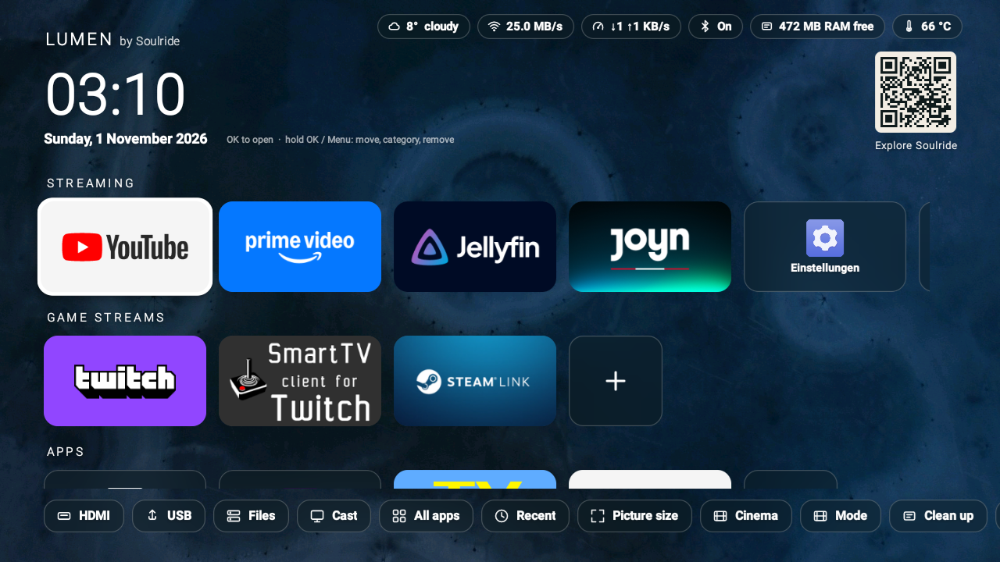
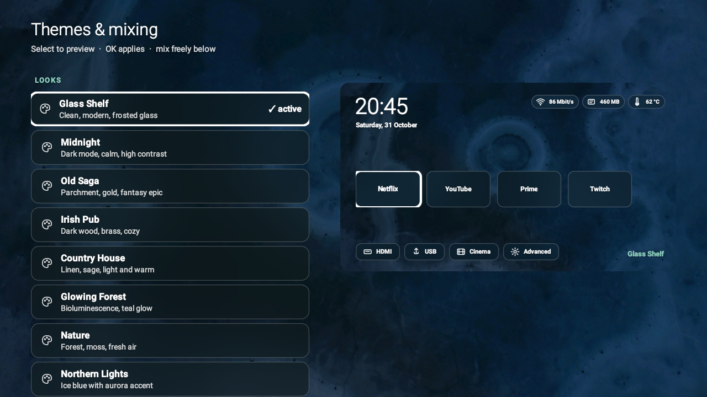
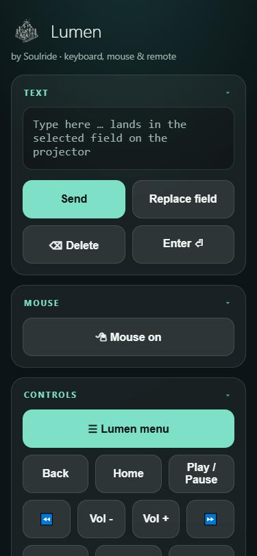
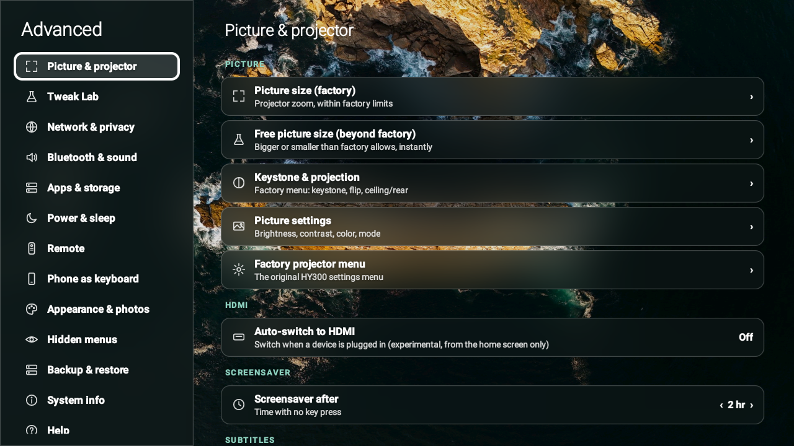
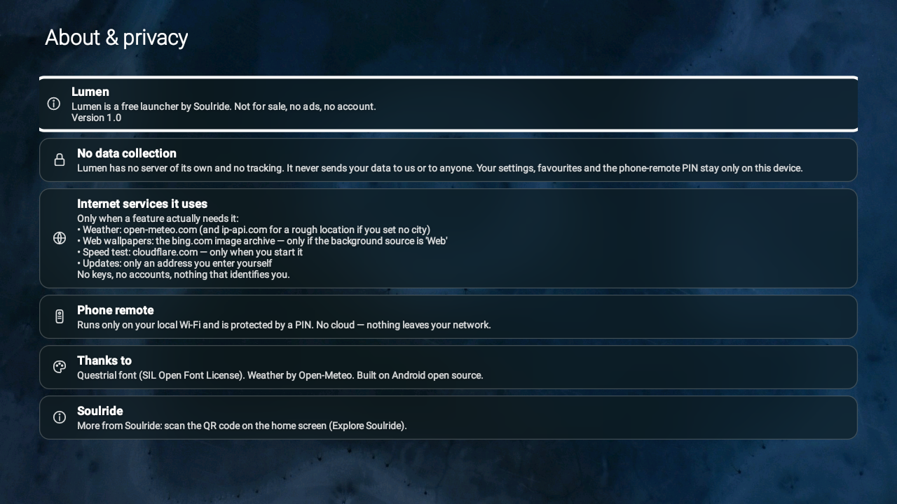
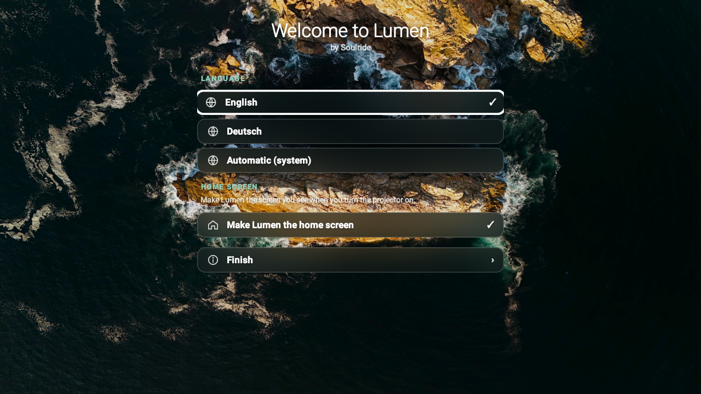

<p align="center">
  
</p>

# Lumen

**A clean home-screen launcher for the HY300 projector** (Allwinner H713, Android 11).

I got one of those cheap little HY300 projectors, and the launcher it shipped with was slow, cluttered and kind of ugly. So I built my own. Lumen puts your apps up front, with a clock, the weather, and a pile of things the stock launcher never had. Free, no ads, no account, and it never phones home.

*by Soulride*

---

## What it does

### A home screen that's actually nice
Your favourites front and center, a big clock, weather and status at a glance. The apps you used last sit in their own row up top, each showing a live preview of where you left off instead of a flat icon. Plus **ten themes** you can mix however you like (fonts, glass, corners, accent colour).



### Your phone as keyboard, mouse & remote
Open a little web page on the same Wi-Fi (or scan the QR on the home screen) and your phone becomes a keyboard that types straight into any field on the projector. There's also a trackpad mouse, a D-pad, media keys and picture modes. Nothing to install.



### One settings menu instead of five
Picture size (even past the factory limits), Wi-Fi, Bluetooth, network with an ad-blocker, backups, system info. All in one place, in Lumen's own look.



### Private by design
No server. No tracking. Nothing leaves your device. There's a plain-language page right in the settings that says exactly what it does and doesn't do.



### Friendly first run
First time you switch it on: pick your language, make Lumen your home screen, done.



English and German throughout.

---

## Install

Lumen is an Android launcher (an APK). A couple of ways onto your HY300 (or another Android TV box):

**Which file?** Both APKs are on the [Releases](../../releases) page.

- HY300 owners: grab `Lumen-1.1-HY300-system.apk`. It installs as a system app and unlocks the extras (live picture zoom, silent self-update, reboot). It also works on other boxes that trust the public AOSP platform key.
- `Lumen-1.1.apk` is the plain build for any other Android TV box. It installs as a normal launcher and the system-only extras just stay hidden.

Same app and same features in both. The only difference is signing: the system build is signed with the AOSP platform key the HY300 trusts, and that is what grants the extra privileges.

**Installing it.** Sideload with `adb install <file>.apk`, or copy it onto a USB stick and open it with a file manager, then press **Home** to choose Lumen as your home screen.

**Build it yourself.** You need the Android SDK command-line tools (build-tools 37, an `android-36` platform) and a JDK. Then one script does everything (aapt2 → javac → d8 → zipalign → apksigner):

```powershell
pwsh -File build.ps1          # normal, debug-signed
pwsh -File build.ps1 -System  # system app
```

Signing keys aren't in here. Drop your own into `keystore/` (normal build) or `platformkey/` (system build). The header of `build.ps1` says exactly what goes where. What's coming next lives in [TODO.md](TODO.md).

---

## Good to know

- The phone remote is plain HTTP on your local Wi-Fi, protected by a 4-digit PIN. Use it on a network you trust.
- Built for an Allwinner **H713** projector (HY300, Android 11, 1280×720), but the code is generic Android.
- The system version is signed with the **public AOSP platform key** (the "test" key). It isn't a secret: it's published in the AOSP source, and it's the key the HY300's firmware trusts. Signing with it only grants system privileges on boxes that trust those keys (a lot of cheap Android TV boxes do). On a properly locked-down device the same APK just installs as a normal app.
- Not a fan of the weather pill? Turn it off in **Advanced › Appearance & photos**.

## License

This is a personal project shared as-is, free to use. The Soulride branding (name, logo, photos, "Explore Soulride" QR) belongs to Soulride. Everything else is yours to tinker with.

*Deutsch:* Ein persönliches Projekt, so wie es ist und kostenlos nutzbar. Die Soulride-Marke (Name, Logo, Fotos, "Explore Soulride"-QR) gehört Soulride. Alles andere kannst du frei anpassen.
